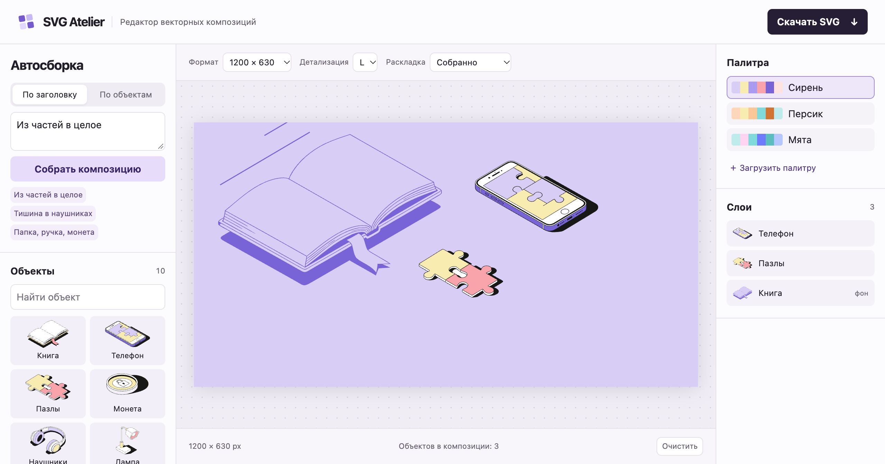
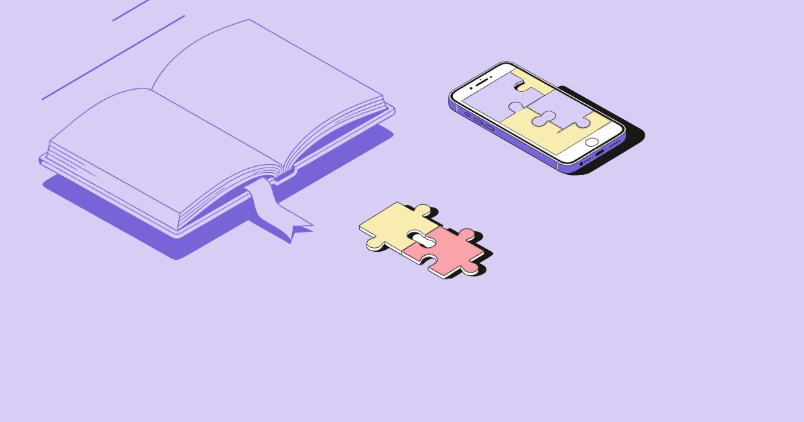
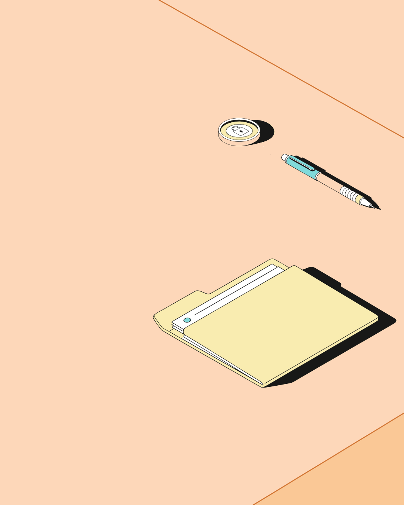

# SVG Atelier

Офлайн-редактор векторных композиций: автоматически собирает иллюстрации из графических компонентов Figma по заголовку, метафоре или списку предметов, позволяет редактировать сцену на холсте и экспортирует структурированный чистый SVG.



## Быстрый запуск

- **Онлайн:** [Редактор SVG Atelier](https://therealfullmetal55555.github.io/svg-atelier/) · [Галерея примеров](https://therealfullmetal55555.github.io/svg-atelier/demo.html)
- **Локально:**
  1. [Скачайте ZIP](https://github.com/therealfullmetal55555/svg-atelier/archive/refs/heads/main.zip) и распакуйте его или клонируйте репозиторий.
  2. Откройте `demo.html` в браузере (для прямого запуска откройте `index.html`).

Проект не требует установки зависимостей (`npm install` не нужен), сборки, локального сервера и API-ключей. Всё работает локально в браузере на чистом JavaScript.

## Готовые примеры

В папке `examples` сохранены три готовые композиции, сгенерированные редактором из исходной библиотеки ассетов:

| Пример | Входные параметры | Результат |
| :--- | :--- | :--- |
| **Из частей в целое**<br><br>[](examples/pieces.svg)<br><br>[Скачать SVG](examples/pieces.svg) | **Запрос:** `«Из частей в целое»`<br>**Режим:** по заголовку<br>**Формат:** 1200 × 630 px (`wide`)<br>**Детализация:** `L`<br>**Раскладка:** «Собранно» (`cluster`)<br>**Палитра:** «Сирень» | Сцена с полноцветным смартфоном, цветными пазлами на переднем плане и фоновой книгой на фактурной сиреневой плитке. Фоновый объект автоматически переведён в монохромный контурный режим. |
| **Тишина в наушниках**<br><br>[](examples/headphones.svg)<br><br>[Скачать SVG](examples/headphones.svg) | **Запрос:** `«Тишина в наушниках»`<br>**Режим:** по заголовку<br>**Формат:** 1080 × 1080 px (`square`)<br>**Детализация:** `S`<br>**Раскладка:** «Со смещением» (`offset`)<br>**Палитра:** «Мята» | Квадратная композиция с наушниками, цветами в вазе и фоновым телефоном на мятно-бирюзовой подложке. Уменьшенный масштаб деталей (`S`) сохраняет читаемость тонких штрихов. |
| **Папка, ручка, монета**<br><br>[](examples/desk.svg)<br><br>[Скачать SVG](examples/desk.svg) | **Запрос:** `Папка, ручка, монета`<br>**Режим:** по объектам<br>**Формат:** 1080 × 1350 px (`tall`)<br>**Детализация:** `L`<br>**Раскладка:** «Под заголовок» (`title`)<br>**Палитра:** «Персик» | Вертикальная деловая композиция со сдвигом предметов в правую часть холста и свободным полем слева для размещения заголовка статьи или текстового блока. |

## Возможности редактора

- **Два сценария автосборки:**
  - *По заголовку или метафоре:* подбор по локальному словарю, тегам и правилам (финансы, звук/тишина, сборка целого, обучение, порядок) с автоматическим переводом третьего объекта в фоновый режим.
  - *По списку предметов:* разбор перечня названий через запятую с фиксацией нераспознанных слов в строке статуса без остановки сборки.
- **Интерактивный холст:** свободное перетаскивание объектов курсором и тачем (`PointerEvents`), пошаговое перемещение клавишами стрелок (с `Shift` с шагом 10 px).
- **Инспектор свойств:** точная корректировка координат X и Y, угла поворота, переключение объектов из встроенной библиотеки в фоновый режим.
- **Управление слоями:** изменение порядка наложения (выше / ниже), дублирование, удаление, добавление объектов из библиотеки в один клик.
- **Цветовые палитры:** переключение между тремя встроенными схемами («Сирень», «Персик», «Мята») и импорт собственных палитр из файлов JSON (`examples/palette.json`), списков HEX-кодов или формата GIMP Palette (`.gpl`).
- **Импорт пользовательских SVG:** загрузка внешних векторных файлов с валидацией контуров и изоляцией идентификаторов.
- **Сохранение сессии:** автоматическая запись текущего состояния сцены в `localStorage`.

## Архитектура

Пайплайн генерации и работы с иллюстрацией:

```
Библиотека векторных объектов → Подбор → Раскладка → Редактирование → Векторный экспорт
```

1. **Библиотека векторных объектов (`library.js`)**  
   Содержит 10 базовых объектов, извлечённых из Figma: книга, телефон, пазлы, монета, наушники, лампа, цветы, папка, ручка, кошелёк. Для каждого объекта сформировано 4 варианта (2 размера детализации `L`/`S` × 2 состояния: полноцветное и монохромное фоновое), а также 6 фоновых фактурных плиток и 3 согласованные цветовые схемы. Контуры нормализованы, габаритные рамки (`box`) предрассчитаны для точного позиционирования.

2. **Подбор объектов (`engine.js`, функция `resolve`)**  
   - В режиме фразы текст нормализуется (приведение регистра, замена `ё` → `е`), отсекаются стоп-слова, рассчитывается релевантность по названиям и семантическим тегам, а также сопоставляются правила типовых метафор. Третий объект по умолчанию становится фоновым.
   - В режиме списка строка разбивается по разделителям, сопоставляются точные и нечёткие совпадения с библиотекой, а пропущенные элементы возвращаются в массиве `missing`.

3. **Раскладка на холсте (`engine.js`, функция `compose`)**  
   Размещает выбранные объекты на холсте выбранного формата (горизонтальный `1200 × 630`, квадратный `1080 × 1080`, вертикальный `1080 × 1350`). Алгоритм опирается на координатные якоря одной из трёх схем (`cluster`, `offset`, `title`) и оптимизирует позицию каждого объекта через функцию стоимости: штрафуются выходы за безопасные поля холста и взаимные перекрытия. Масштаб объектов вычисляется единообразно для всей сцены, сохраняя пропорции исходных ассетов.

4. **Интерактивное редактирование (`app.js`)**  
   Управляет состоянием сцены, связывает холст с панелями инструментов, обрабатывает манипуляции с объектами, перекрашивает контуры при смене цветовой схемы и сохраняет изменения в локальное хранилище браузера.

5. **Векторный экспорт (`engine.js`, функция `svg`)**  
   Формирует чистый итоговый SVG-документ. Каждый объект помещается в отдельную именованную группу `<g id="{key}-{id}" aria-label="{name}">` с атрибутом `transform`, а фоновый узор изолируется через `<clipPath>`. Результирующий файл не содержит растра или внешних скриптов и готов к верстке либо дальнейшему редактированию в Figma и Illustrator.

## Инструменты и исходные материалы

- **Стек:** чистый JavaScript (ES2022), HTML5, CSS3. Без рантайм-зависимостей и сторонних фреймворков.
- **Инструменты разработки:** при проектировании логики раскладки, правил морфологического подбора и проверочных сценариев использовался **OpenAI Codex**. **Gemini** помог оформить репозиторий.
- **Графика:** векторные ассеты получены из оригинального файла Figma тестового задания и подготовлены с помощью скрипта `scripts/extract.py`.

## Проверка проекта

Для автоматических проверок нужен Node.js 20 или новее. Скрипт проверяет библиотеку, оба режима подбора, примеры, палитры и структуру экспортируемого SVG.

```bash
node scripts/check.cjs
```

Для пересборки файлов в папке `examples/`:

```bash
node scripts/check.cjs --examples
```
